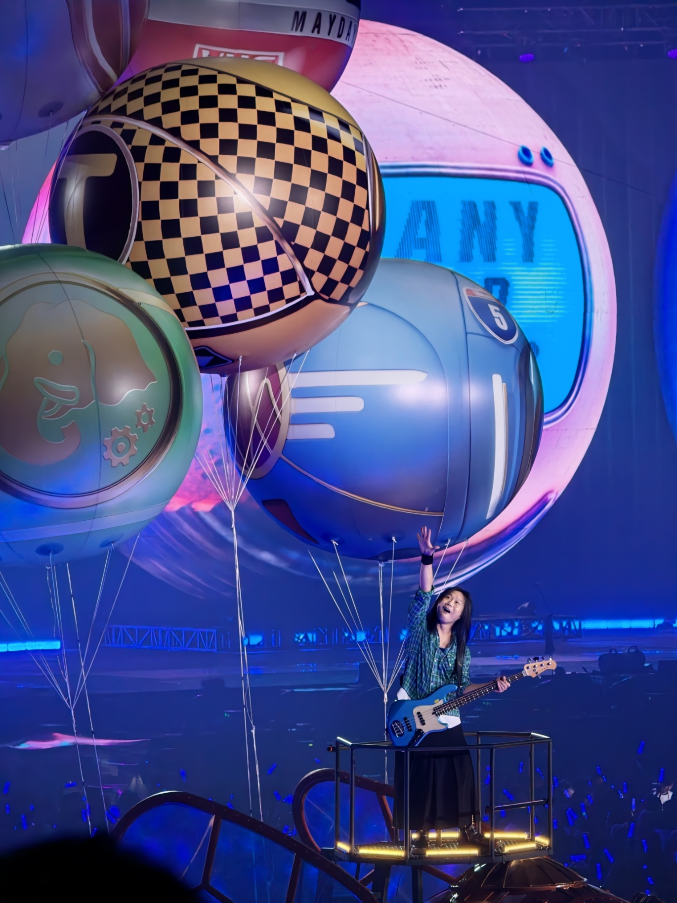

# comfyUI生成圖片：五月天瑪莎
- 原圖(20260712五月天5525+2)

- 生成的圖(兩次生成結果)

- 完整工作流截圖

- 使用的正反提示詞
1. 正提示詞：pink balloons, a person playing a yellow electric guitar on a stage

2. 反提示詞：loPoor quality, incorrect anatomical structures, extra or missing fingers/toes/limbs, distorted figures, or altered colors

- 個人心得
第一次生成的結果大致上是將整體飽和度拉低，同時對人物稍作修改，並沒有達到預期的粉色汽球及黃色電吉他。在調整了cfg和去雜訊度後生成了第二次結果，這次有達到預期的粉色汽球及黃色電吉他但是汽球是加了粉色而非變成全粉色，同時整個原圖基本被修改覆蓋掉了，我覺得應該是我cfg調太高，加上指令不夠精確，才導致生成結果並非最初希望的樣子。